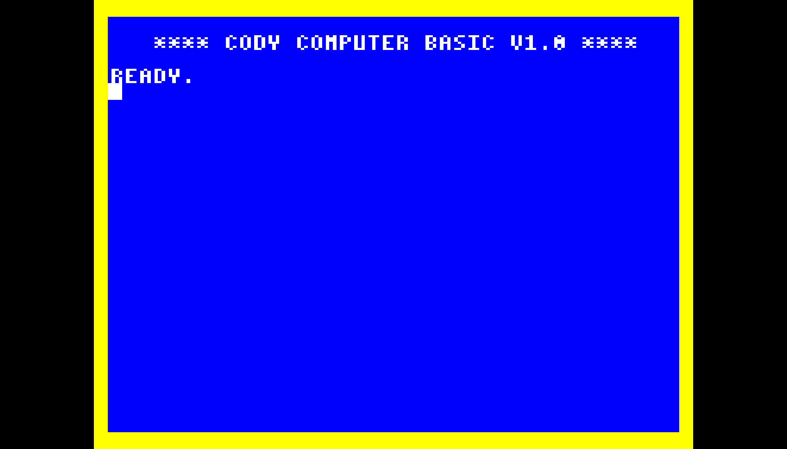
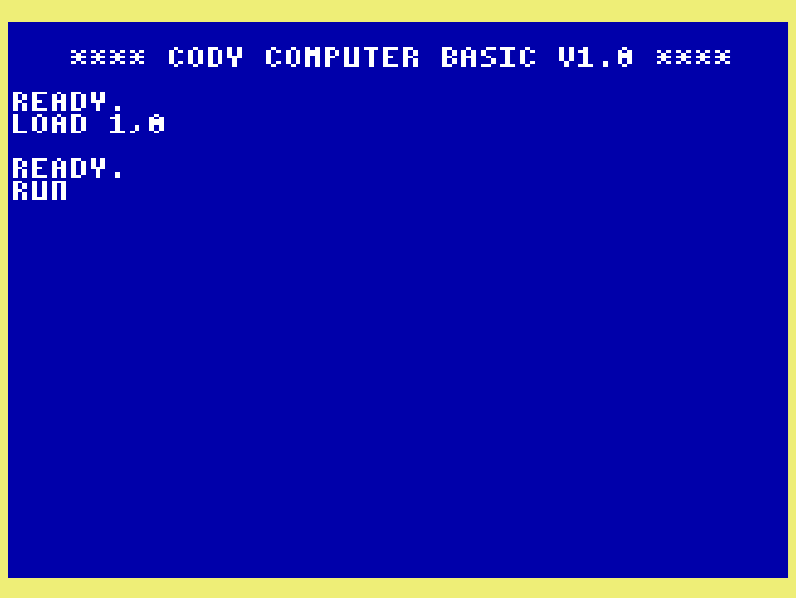
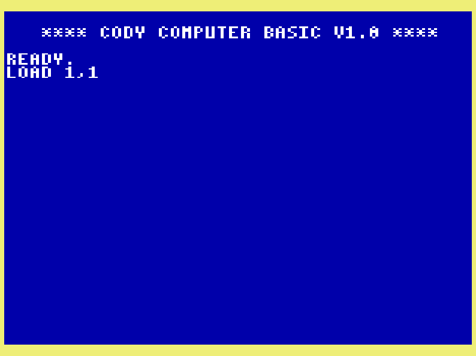
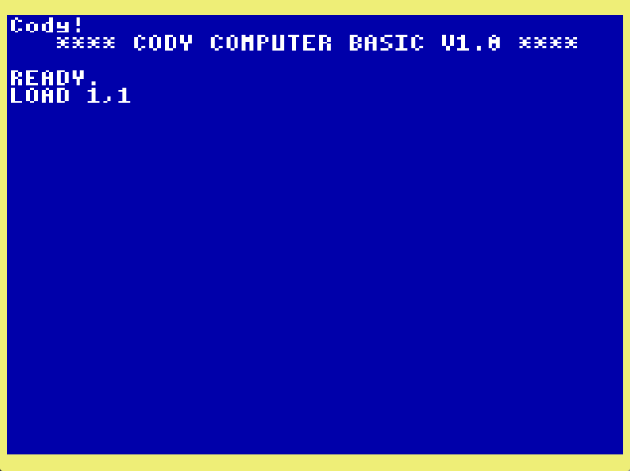

# cody_emulator

Emulate the [Cody Computer](https://www.codycomputer.org/).

Contains a 65C02 emulator and a re-implementation of the Cody firmware.

## Running from source
```
> cargo run --release -- --help
Usage: cody_emulator [OPTIONS] [FILE]

Arguments:
  [FILE]  Load the given binary file into memory (by default at address 0xE000), load address can be changed with the --load-address option

Options:
      --as-cartridge                 DEPRECATED (use --cartridge instead): Load the binary file as a cartridge, expects the file to have a cartridge header
      --load-address <LOAD_ADDRESS>  Change the load address of the binary file, default is 0xE000
      --ram <RAM>                    Load the given binary file into the RAM (address 0x0200)
      --shared-ram <SHARED_RAM>      Load the given binary file into the shared RAM (address 0xA000)
      --rom <ROM>                    Load the given binary file into the ROM (address 0xE000)
      --cartridge <CARTRIDGE>        Load the given binary file as a cartridge, expects the file to have a cartridge header, can be used multiple times
      --nmi-vector <NMI_VECTOR>      Override Non-Maskable Interrupt Vector (0xFFFA)
      --reset-vector <RESET_VECTOR>  Override Reset Vector (0xFFFC)
      --irq-vector <IRQ_VECTOR>      Override Interrupt Vector (0xFFFE)
      --uart1-source <UART1_SOURCE>  Path of file used to fill the UART1 receive buffer with bytes
      --fix-newlines                 This option will normalize newlines when reading text data for the UART (always use with BASIC code!)
      --physical-keyboard            Emulate the keyboard by physically mapping the cody keyboard, without respecting the host's layout
      --fast                         Run the cpu as fast as possible
      --writable-vectors             Make the NMI/RESET/IRQ vectors writable during runtime
      --no-sound                     Disable sound playback
  -v, --verbose...                   Each time this option is added increases the default logging level
  -h, --help                         Print help (see more with '--help')
  -V, --version                      Print version
```

### Examples
Run Cody BASIC: `cargo run --release -- codybasic.bin`


Run Bitmap example: `cargo run --release -- --cartridge codybitmap.bin`


Run Codybros example: `cargo run --release -- --cartridge codybros.bin`


Run Codylander example from UART: `cargo run --release -- --fix-newlines --uart1-source codylander.bas codybasic.bin`



Run Codycart example from UART: `cargo run --release -- --uart1-source codycart.bin codybasic.bin`


